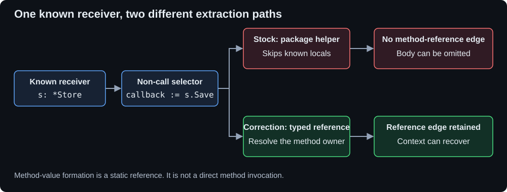

# UnvibeCode: typed Go callbacks lose implementation context

A reproducible Track 1 engineering investigation, with a reference correction and measured limits.

[](https://github.com/Sohamgaonkhadkar/UnvibeCode-Engineering-Investigation/actions/workflows/go-method-values.yml)

**[Results](#measured-results) · [Why two bodies remain missing](#why-two-bodies-remain-missing) · [Reproduce](#reproduce) · [Evidence guide](#evidence-guide)**

> **Finding:** typed Go method values can lose their method-definition links and implementation context. Controlled experiments recover 13 production references and five complete method bodies on a pinned go-redis checkout. A matched 0.4.0 client comparison independently reproduces the minimal symptom.

## The defect

An explicitly typed receiver loses its implementation relationship when its method becomes a callback:

```go
func Run(s *Store) {
    callback := s.Save
    callback()
}
```

In the published 0.3.15 engine, a direct `s.Save()` emits a typed method usage. The non-call selector `s.Save` instead goes through `package_selector()`, which returns for known local variables. The receiver's correct type never reaches owner-aware method resolution.



**Text alternative:** known receiver → non-call selector → stock package-only helper drops the reference → no method-definition edge. The correction preserves a typed reference and resolves its method owner.

The correction records a reference. Forming a method value does not invoke it; see [Go's method-value semantics](https://go.dev/ref/spec#Method_values).

## What was verified

| Verification layer | Scope and result |
|---|---|
| Root cause and reference correction | Installed UnvibeCode **0.3.15**, both shipped graph implementations |
| Harmless compiling controls | Stock, repeat, wrapper control, corrected, restored; package-value and function-field controls |
| Public-repository replication | Unchanged [redis/go-redis at `5cba5e182946cf18a757718938bc43910e589466`](https://github.com/redis/go-redis/tree/5cba5e182946cf18a757718938bc43910e589466) |
| Independent type check | **13/13** production source/receiver/definition identities verified by Go |
| Current-client check | Two genuine **0.4.0 client** code-map exports captured on 12 November; same observable omission and matched wrapper control |
| Originality refresh | **570** open/closed issue records through **#682**: 567 nonempty bodies and 3 empty bodies; nearest-report comments checked |

[PyPI lists 0.4.0 as the latest published release](https://pypi.org/project/unvibecode/) (checked 12 November 2026). The 0.4.0 hosted backend revision is not exposed. Source-level causal inspection and the 13-reference public-project measurements belong to 0.3.15; the current-client check independently verifies the small fixture's observable behavior.

## Measured results

### Graph relationships on the public go-redis commit

Both 0.3.15 graph copies reproduce these results:

| Metric | Stock | Corrected | Restored |
|---|---:|---:|---:|
| Total relationships | 23,448 | **23,527** | 23,448 |
| Production references gained versus stock | 0 | **13** | 0 |
| Test references gained versus stock | 0 | 66 | 0 |
| Stock relationships removed | 0 | **0** | 0 |

**Stock** is the affected release. **Corrected** applies only the transient reference correction. **Restored** removes that correction and intentionally reproduces the original omission. Zeros in the delta rows are measured baselines, not missing results.

The 79 additions are 13 production references across six file pairs and 66 test references. They are not 79 proven runtime calls or application defects.

### Complete method bodies in focused context

A body counts as complete only when every required nonblank source line matches the actual selected code. These five targets have the same result at both Optimal and Wider:

| Caller → required method | Stock | Corrected | Restored |
|---|---:|---:|---:|
| `autopipeline_cluster_fd.go` → `ClusterClient.processPipelineRetries` | 0/72 | **72/72** | 0/72 |
| `himport_cluster.go` → `ClusterClient.ForEachMaster` | 0/31 | **31/31** | 0/31 |
| `himport_cluster.go` → `Ring.ForEachShard` | 0/32 | **32/32** | 0/32 |
| `multidb.go` → `multidbCore.processPipeline` | 0/3 | **3/3** | 0/3 |
| `osscluster_router.go` → `ClusterClient.ForEachMaster` | 0/31 | **31/31** | 0/31 |

Thus **5 of 7** distinct source-specific method definitions are newly recovered in each scope. The scopes share inputs and are not independent tasks. The complete-repository ZIP contains every source file throughout; the measured loss is in the selected focused context.

## Why two bodies remain missing

The [line-coverage and budget audit](investigations/go-method-values/evidence/context-selection-audit.json) makes these limits explicit:

| Target from `multidb.go` | Optimal: stock → corrected → restored | Wider: stock → corrected → restored |
|---|---|---|
| `multidbCore.process` | 0/215 → 0/215 → 0/215 | 215/215 → 215/215 → 215/215 |
| `multidbCore.processTxPipeline` | 0/135 → 0/135 → 0/135 | 0/135 → 0/135 → 0/135 |

The corrected export **does contain the resolved reference edges** for these methods. Its fixed-size selector still excludes their bodies: the saved MultiDB selections estimate **44,997/45,000** tokens at Optimal and **74,999/75,000** at Wider.

A controlled experiment leaves source, corrected graph, chunking and selection ranking unchanged and increases only one scope's maximum to 200,000 tokens. Both bodies then become complete in both scopes. This diagnoses a separate selection-capacity limit. **The main 5/7 result still uses the original budgets.** Raising the diagnostic budget is not presented as a production fix.

The reference correction repairs extraction. The capacity experiment separately measures whether resolved implementations fit into focused context.

## Current 0.4.0 client: actual downloaded evidence

[Two small captured ZIPs and their offline checker](investigations/go-method-values/evidence/latest-client-verification.json) reproduce the observable issue without new service requests:

| Input | `Store.Save` relationship | `store.go` in Optimal and Wider |
|---|---:|---|
| `callback := s.Save` | 0 | Absent |
| `callback := func() { s.Save() }` | 1 | Included |

The uploaded source texts differ in exactly that expression. The other three Go files match. This does not establish general wrapper equivalence when a receiver can be reassigned.

Both downloaded runs mark code understanding **COMPLETED** and the overall review **PARTIAL**. Business analysis stopped at Step 04 with no evidence-valid business path fragments. That lane is not used to establish this code-graph defect, and no completed business-risk review is claimed. [#682](https://github.com/FinanceFlash/unvibecode/issues/682) separately announces a business-risk API hold through 16 November; its causal role in these particular failures is not established.

## Reproduce

From this checkout, with Python 3.12+, Git and Go on PATH (CI uses Go 1.27.3):

```sh
python -m pip install -r investigations/go-method-values/reproduction/requirements.txt

# Compiling fixture, both parsers, correction and restoration
python investigations/go-method-values/reproduction/verify.py --work ci-logs/minimal --output ci-logs/minimal.json

# Unchanged public source and actual focused exports
git clone https://github.com/redis/go-redis.git .local-go-investigation/redis
git -C .local-go-investigation/redis checkout 5cba5e182946cf18a757718938bc43910e589466
python investigations/go-method-values/reproduction/verify.py --repo .local-go-investigation/redis --work ci-logs/redis --output ci-logs/redis.json

# Independent compiler oracle
go build -o ci-logs/compiler-oracle investigations/go-method-values/reproduction/compiler_oracle.go
ci-logs/compiler-oracle -repo .local-go-investigation/redis -package . -cases ci-logs/redis-compiler-cases.json -output ci-logs/compiler-results.json

# Replay the captured current-client evidence; no network or service required
python investigations/go-method-values/reproduction/check_current_client.py --output ci-logs/current-client.json

# Explain line coverage and the separate capacity limit
python investigations/go-method-values/reproduction/explain_context.py --repo .local-go-investigation/redis --artifacts ci-logs/redis/public/00a --verification ci-logs/redis.json --budget-control-work ci-logs/budget-control --output ci-logs/context-audit.json
```

On Windows, give the compiler executable an `.exe` suffix. First-use parser setup needs network access. Setup failures fail verification. Public Redis tests are compiled in CI; server-dependent integration tests are not executed.

The [workflow](.github/workflows/go-method-values.yml) preserves logs, compiler results and actual exported ZIPs. A green affected-version verification means the defect and controls reproduced as expected; it does not mean stock UnvibeCode was fixed.

## Evidence guide

| Evaluation area | Evidence |
|---|---|
| Technical depth and root cause | [Source stages and causal controls](investigations/go-method-values/ROOT_CAUSE.md), [reference correction](investigations/go-method-values/solution/method_values.py) |
| Reproducibility | [Compiling fixtures and public-project verifier](investigations/go-method-values/reproduction/verify.py), [recorded measurements](investigations/go-method-values/evidence/verification.json) |
| Developer impact | [Full technical report](investigations/go-method-values/README.md), [exact focused-context coverage and capacity control](investigations/go-method-values/evidence/context-selection-audit.json) |
| Independent validation | [Go compiler identities](investigations/go-method-values/evidence/verification-compiler-cases.json), [ordinary CLI cross-check](investigations/go-method-values/evidence/cli-verification.json) |
| Current-client behavior | [Captured 0.4.0 comparison](investigations/go-method-values/evidence/latest-client-verification.json), [offline replay](investigations/go-method-values/reproduction/check_current_client.py) |
| Originality | [Mechanism-level duplicate review](investigations/go-method-values/DUPLICATE_CHECK.md), [candidate decisions](investigations/go-method-values/CANDIDATES.md) |
| Issue report | [Nine-section Track 1 report](investigations/go-method-values/submission/GITHUB_ISSUE.md) |
| Continuous verification | [Passing Linux and Windows run](https://github.com/Sohamgaonkhadkar/UnvibeCode-Engineering-Investigation/actions/runs/43203777303) at `fcfe9ca49869d0015aa4af29e4d2d6dd79305a29`; downloadable logs and generated artifacts |

## Scope and limitations

The proposed correction is a tested reference implementation; it is not a shipped UnvibeCode fix. The public-project recovery counts apply to the inspectable 0.3.15 engine. The 0.4.0 evidence covers a matched minimal fixture, with an undisclosed hosted backend revision and partial business analysis.

This investigation establishes a static method-reference omission and its focused-context impact. It does not establish general indirect-call resolution, ecosystem prevalence, or a changed business-risk verdict. The two selection scopes share inputs. Originality is assessed against the dated issue inventory, rather than guaranteed against later reports.

Earlier JSONC and named-result investigations are preserved in Git history and excluded because upstream #451 and #596 cover their causes.
