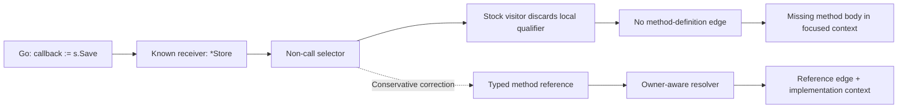

<div align="center">

# UnvibeCode — Go Method-Value Graph Integrity

**A reproducible investigation of missing Go callback-to-implementation relationships**

[](https://github.com/Sohamgaonkhadkar/UnvibeCode-Engineering-Investigation/actions/workflows/go-method-values.yml)
[](https://github.com/FinanceFlash/unvibecode)
[](investigations/go-method-values/evidence/ci-snapshot.json)

**[The defect](#the-defect) · [Results](#measured-impact) · [Reproduce](#reproduce) · [Evidence](#verification-and-evidence) · [Limitations](#scope-and-limitations)**

</div>

---

## Overview

UnvibeCode builds a source-code relationship graph and exports focused context for developers inspecting unfamiliar repositories. This investigation identifies a specific blind spot in its Go parser: **a method used as a function value does not retain the method-definition relationship, even when the receiver type is already known.**

The failure is demonstrated on UnvibeCode **0.3.15** using compiling Go fixtures and an unchanged, pinned [redis/go-redis](https://github.com/redis/go-redis) checkout. We isolate the failing visitor branch, verify the correct method owners with Go's type checker, test a conservative reference correction against both shipped graph implementations, and inspect actual exported context.

This is an **independent engineering investigation**, not a patch released by UnvibeCode. The current 0.4.0 hosted engine has **not** been independently verified by these tests; conclusions below apply to the published 0.3.15 engine.

### Investigation at a glance

| Dimension | Evidence |
|---|---|
| Failure | Go typed method values disappear from the resolved source graph |
| Root cause | Non-call `selector_expression` bypasses typed owner resolution |
| Target | UnvibeCode `0.3.15`, both shipped Go graph implementations |
| Public fixture | [redis/go-redis at `5cba5e182946cf18a757718938bc43910e589466`](https://github.com/redis/go-redis/tree/5cba5e182946cf18a757718938bc43910e589466) |
| Reproducibility | Original → repeat → wrapper control → corrected → restored |
| Independent oracle | Go compiler, **13/13** production selector identities checked |
| User-visible outcome | **5/7** complete source-specific method definitions newly available in focused context |
| Technical detail | [Investigation report](investigations/go-method-values/README.md) · [Root cause](investigations/go-method-values/ROOT_CAUSE.md) |
| Maintainer-ready report | [Nine-section issue report](investigations/go-method-values/submission/GITHUB_ISSUE.md) |

## The defect

This is valid Go:

```go
func run(s *Store) {
    callback := s.Save // form a bound method value
    callback()         // invoke the stored value later
}
```

A direct `s.Save()` call is resolved to `Store.Save`. In UnvibeCode 0.3.15, however, the non-call selector `s.Save` is processed via `package_selector()`, which returns early when `s` is a known local variable. The method's receiver type is already in the environment but no typed usage reaches the owner-aware resolver.



The correction records a **reference**, not a direct invocation. This distinction follows [Go's method-value semantics](https://go.dev/ref/spec#Method_values).

## Measured impact

### Graph-level results

Both shipped engine copies reproduce the same reversible comparison on the unchanged go-redis commit.

| Metric | Stock | Corrected | Restored |
|---|---:|---:|---:|
| Graph relationships | 23,448 | **23,527** | 23,448 |
| Additional production method references | — | **13** | — |
| Additional test references | — | 66 | — |
| Existing relationships removed | — | **0** | — |

The 79 additions are **not** 79 new runtime calls. They are 13 production references and 66 test references; an independent compiler check validates all 13 production source/receiver/definition identities.

### Actual focused-context results

For seven distinct production caller→callee identities, we checked that **every nonblank line of the full method definition** appears in the selected source, not merely that its file is present.

| Production caller → required method | Stock | Corrected |
|---|---|---|
| `autopipeline_cluster_fd.go` → `ClusterClient.processPipelineRetries` | Absent | **Complete** |
| `himport_cluster.go` → `ClusterClient.ForEachMaster` | Absent | **Complete** |
| `himport_cluster.go` → `Ring.ForEachShard` | Absent | **Complete** |
| `multidb.go` → `multidbCore.processPipeline` | Absent | **Complete** |
| `osscluster_router.go` → `ClusterClient.ForEachMaster` | Absent | **Complete** |
| `multidb.go` → `multidbCore.process` | Incomplete at Optimal; complete at Wider | Unchanged |
| `multidb.go` → `multidbCore.processTxPipeline` | Incomplete | Unchanged |

**Five of seven** complete implementations are newly recovered at both Optimal and Wider scopes. The remaining two bound the result honestly; we do not call a partial implementation a success. The complete-repository ZIP still contains the source, so the observed defect is **focused-context omission**, not source-code deletion.

For example, a developer exploring MultiDB callback installation can see a reference without the actual `processPipeline` implementation in `multidb_pipeline.go`. The correction restores that implementation in the focused export.

## Reproduce

**Prerequisites:** Python 3.12+, Git, Go on PATH, and a network connection for initial dependency/grammar installation. The pinned go-redis checkout requires a compatible Go release; CI uses Go 1.27.3.

```bash
git clone https://github.com/Sohamgaonkhadkar/UnvibeCode-Engineering-Investigation.git
cd UnvibeCode-Engineering-Investigation
git switch codex/track1-original-investigation

python -m venv .venv
# Activate .venv for your shell
python -m pip install -r investigations/go-method-values/reproduction/requirements.txt

# Minimal reproducible failure, controls, correction and restoration
python investigations/go-method-values/reproduction/verify.py \
  --work ci-logs/minimal --output ci-logs/minimal.json

# Public-repository replication at a fixed revision
git clone https://github.com/redis/go-redis.git .local-go-investigation/redis
git -C .local-go-investigation/redis checkout 5cba5e182946cf18a757718938bc43910e589466
python investigations/go-method-values/reproduction/verify.py \
  --repo .local-go-investigation/redis \
  --work ci-logs/redis --output ci-logs/redis.json

# Independent Go type-checker validation of production source positions
go build -o ci-logs/compiler-oracle investigations/go-method-values/reproduction/compiler_oracle.go
ci-logs/compiler-oracle -repo .local-go-investigation/redis \
  -package . -cases ci-logs/redis-compiler-cases.json \
  -output ci-logs/compiler-results.json
```

On Windows, name the Go oracle executable `compiler-oracle.exe`. The verifier fails on missing grammar setup or unexpected graph/selection differences; it does not turn setup failures into passing results.

## Verification and evidence

| Question | Reproducible record |
|---|---|
| Can the failure be recreated locally? | [Verifier](investigations/go-method-values/reproduction/verify.py) and [compiling fixtures](investigations/go-method-values/reproduction/fixtures/source.go) |
| Which stage drops the reference? | [Source-level root cause](investigations/go-method-values/ROOT_CAUSE.md) |
| What actually changed in the graph/context? | [Machine-readable measurements](investigations/go-method-values/evidence/verification.json) |
| Are the production targets type-correct? | [Go compiler oracle](investigations/go-method-values/reproduction/compiler_oracle.go), [CI provenance](investigations/go-method-values/evidence/ci-snapshot.json) |
| Does the standard local CLI produce the same stock export? | [CLI export comparison](investigations/go-method-values/evidence/cli-verification.json) |
| Is the proposed correction narrowly scoped? | [Reference correction](investigations/go-method-values/solution/method_values.py) |
| What should maintainers reproduce? | [Maintainer issue report](investigations/go-method-values/submission/GITHUB_ISSUE.md) |

The [GitHub Actions workflow](.github/workflows/go-method-values.yml) runs compiling controls on Linux and Windows, public graph/context validation on Linux, and the Go compiler oracle. CI artifacts contain detailed logs and generated local bundles.

### Repository structure

```text
.
├── README.md
├── .github/workflows/go-method-values.yml
└── investigations/go-method-values/
    ├── README.md
    ├── ROOT_CAUSE.md
    ├── reproduction/
    │   ├── verify.py
    │   ├── helpers.py
    │   ├── compiler_oracle.go
    │   ├── requirements.txt
    │   └── fixtures/
    ├── solution/method_values.py
    ├── evidence/
    │   ├── verification.json
    │   ├── verification-compiler-cases.json
    │   ├── cli-verification.json
    │   └── ci-snapshot.json
    └── submission/GITHUB_ISSUE.md
```

## Scope and limitations

- **Version boundary:** All verified engine claims target `0.3.15`. The 0.4.0 client uses hosted analysis; no current hosted-service equivalence or resolved/unresolved verdict is claimed.
- **Correct semantics:** Method-value formation is a static reference, not proof of immediate execution; this is not general higher-order control-flow analysis.
- **Complete vs. focused ZIP:** The complete ZIP retains source; only some per-file Optimal/Wider selections omit needed implementations.
- **Negative controls:** Package-function values and unrelated function-valued fields remain unchanged; two source-specific method definitions are not fully recovered.
- **Source integrity:** Public repository and installed engine source hashes are compared before and after experiments. The test correction is transient.
- **No inflated impact:** Graph edge counts, test references, and overlapping selection scopes are not presented as independent developer outcomes.
- **Other research:** Earlier independent experiments remain traceable in [the repository's Git history](https://github.com/Sohamgaonkhadkar/UnvibeCode-Engineering-Investigation/commits/main); these are deliberately excluded from this focused submission tree.

## Reproducibility contract

This repository is a **technical evidence package**. It is not an upstream UnvibeCode fork, a shipped production patch, or proof of a change in hosted risk findings. The issue report describes one narrowly scoped defect and includes its causal controls, bounded impact, and closest reported neighboring mechanisms.

---

<sub>Independent engineering research · [Source product](https://github.com/FinanceFlash/unvibecode) · [Technical issue report](investigations/go-method-values/submission/GITHUB_ISSUE.md)</sub>
