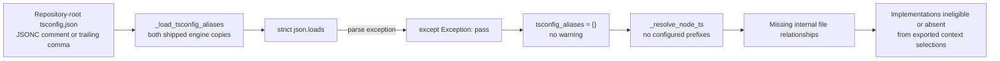
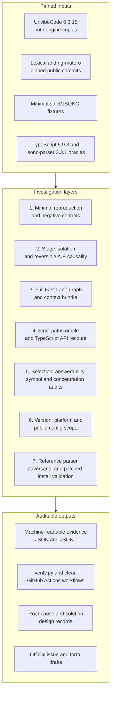

# UnvibeCode Engineering Investigation

## Legal JSONC in `tsconfig.json` silently empties the TypeScript path-alias table

**Cohort 3 · Track 1 · UnvibeCode 0.3.15**

This repository is a self-contained engineering investigation of one
deterministic UnvibeCode defect: when the supported repository-root
`tsconfig.json` contains a JSONC comment or trailing comma, UnvibeCode
discards the entire configured TypeScript path-alias table without a warning.
Configured imports then lose their file relationships, and the exported
Connected Code context can look legitimately sparse when the real problem is
that the configuration never loaded.

The investigation does not stop at a minimal reproducer. It establishes the
earliest failing stage, proves causality reversibly on both shipped resolver
copies, verifies the lost relationships against TypeScript itself, follows the
effect into the actual exported context bundles, replicates it on a second
public repository, bounds the release/platform/public-config scope, and
supplies a tested maintainer-adaptable reference correction.

> **Status:** the evidence is maintained in personal evidence-repository
> [PR #2](https://github.com/Sohamgaonkhadkar/UnvibeCode-Engineering-Investigation/pull/2).
> This investigation has **not** filed its own upstream issue or Google Form,
> so it is not yet an officially ranked submission. A final duplicate sweep
> on 2026-11-04 found that upstream
> [#451](https://github.com/FinanceFlash/unvibecode/issues/451) now reports
> the same JSONC-empty-alias mechanism; the draft in `submission/` is retained
> as independent corroborating evidence and must not be filed unchanged as a
> duplicate report. This repository does not claim a shipped UnvibeCode fix.

---

## At a glance

| Item | Value |
|---|---|
| Challenge track | Cohort 3, Track 1 — product/engineering investigation |
| Product/version | UnvibeCode `0.3.15`, installed normally |
| Defect | Strict `json.loads` rejects legal JSONC in root `tsconfig.json`; `except Exception: pass` leaves `tsconfig_aliases = {}` with no warning |
| Responsible stage | `LanguageAwareImportResolver._load_tsconfig_aliases`, duplicated in both shipped engine copies |
| Primary repositories | `meta/lexical@164af6a4df7114f35724c472152ca74877b6bd04`; `ng-matero/ng-matero@d351bf5957d8c6dc9eca79d0c9b260c5b8d07822` |
| Independent oracles | TypeScript 5.9.3; Microsoft `jsonc-parser` 3.3.1 for the reference parser |
| Latest fully indexed functional snapshot | `6c6c6b2cd8d046db6e005ea19f5d188ec5e71cfb` — all 10 PR checks passed |
| Evidence PR | [#2](https://github.com/Sohamgaonkhadkar/UnvibeCode-Engineering-Investigation/pull/2) |
| Official issue/form | Not filed/submitted by this investigation; upstream #451 now covers the same mechanism, so the draft is corroborating material rather than a new-issue text |

### Headline results

| Evidence layer | Result |
|---|---|
| Lexical graph | Removing only five comment lines raises internal file edges **1,263 → 5,519** |
| Compiler-verified relationships | **4,256/4,256** gained Lexical relationships match the `paths` oracle and TypeScript 5.9.3, with zero mismatches |
| Exported Lexical context | **2,707** verified direct dependencies are absent from as-is Optimal selections and restored in the control; **3,345** at Wider |
| Developer-task evidence | Lexical final-artifact tasks: **0/6 as-is → 6/6 control/corrected**; ng-matero: **0/3 → 3/3** |
| Exhaustive symbol evidence | Of 10,703 eligible Lexical imported-symbol instances, **8,163** additional definition/export instances become available at Optimal after correction |
| Independent replication | ng-matero edges **130 → 241**; **111** verified relationships and **107** direct dependencies restored |
| Release scope | The same vulnerable loader AST appears in all **212 engine copies** across all **106 published PyPI wheels** for 0.3.0–0.3.15 |
| Reference parser | **514/514** valid differential documents agree with TypeScript; **2,277** adversarial cases produce zero critical divergences |
| Patched-install rehearsal | Both normally loaded engine copies and full Fast Lane pass with no monkeypatching, then restore to recorded stock hashes |

The numbers are deliberately reported with their denominators and caveats in
the detailed sections below. In particular, graph edges are **not** treated as
a one-for-one proxy for context loss or LLM answer quality.

---

## Contents

1. [Problem-statement alignment](#1-problem-statement-alignment)
2. [Defect and root cause](#2-defect-and-root-cause)
3. [Investigation approach and architecture](#3-investigation-approach-and-architecture)
4. [Findings](#4-findings)
5. [Reference solution](#5-reference-solution)
6. [Reproduction and verification](#6-reproduction-and-verification)
7. [Repository guide](#7-repository-guide)
8. [Limits and non-claims](#8-limits-and-non-claims)
9. [Current status and acceptance criteria](#9-current-status-and-acceptance-criteria)

---

## 1. Problem-statement alignment

### 1.1 Scope lock

This is a **single-defect, Track 1 investigation**. The claim is limited to
the loader behaviour UnvibeCode already intends to support:

- one repository-root `tsconfig.json`;
- `compilerOptions.baseUrl` and `compilerOptions.paths` in that file;
- legal JSONC comments and trailing commas in the same file;
- the two shipped copies of `_load_tsconfig_aliases` in UnvibeCode 0.3.15;
- the local resolved graph and exported repository-context bundle.

The investigation does **not** ask one fix to add nested-tsconfig discovery,
`extends`, project references, Vite aliases, or complete TypeScript `paths`
pattern semantics. Those adjacent behaviours were used only as boundaries or
negative controls. Keeping the mechanism narrow makes the causal claim
testable and distinguishes it from nearest-neighbour issues such as post-load
target-wildcard substitution (#442), Vite/non-root alias handling (#374),
ordinary `baseUrl`-only resolution (#452), and inherited/effective config via
`extends` (#455). Upstream #451 is **not** a neighbour distinction: it reports
the same JSONC parse-failure mechanism and is treated as a filing duplicate.

### 1.2 How the work maps to the evaluation dimensions

| Evaluation dimension | What this repository provides | Start here |
|---|---|---|
| Technical depth / root cause | Stage-by-stage decomposition, both duplicated loaders, reversible A/B/C/D/E causality, strict `paths` and TypeScript-API recounts, parser grammar/resource hardening | [`ROOT_CAUSE.md`](ROOT_CAUSE.md), [`solution/README.md`](solution/README.md) |
| Reproducibility / evidence | One-command verifier, pinned package/repository/oracle versions, machine-readable evidence, input/output hashes, clean GitHub Actions, exact-success/failure semantics | [`reproduction/verify.py`](reproduction/verify.py), [`evidence/tsconfig-jsonc/CI_VERIFICATION.md`](evidence/tsconfig-jsonc/CI_VERIFICATION.md), [`evidence/tsconfig-jsonc/ARTIFACT_MANIFEST.md`](evidence/tsconfig-jsonc/ARTIFACT_MANIFEST.md) |
| Developer impact | Actual exported selections, predeclared answer-bearing task audit, exhaustive symbol-evidence audit, second public repository, bounded public-config exposure and direct loader execution | [`evidence/tsconfig-jsonc/CONTEXT_SELECTION_IMPACT.md`](evidence/tsconfig-jsonc/CONTEXT_SELECTION_IMPACT.md), [`evidence/tsconfig-jsonc/ANSWERABILITY_AUDIT.md`](evidence/tsconfig-jsonc/ANSWERABILITY_AUDIT.md), [`evidence/tsconfig-jsonc/SYMBOL_EVIDENCE_AUDIT.md`](evidence/tsconfig-jsonc/SYMBOL_EVIDENCE_AUDIT.md) |
| Originality | Independent discovery documented in this repository before upstream #451 was filed; mechanism-level sweeps through #473 and #532 (434 issues, 2026-11-05) classify #451 as the same mechanism and #452/#455/#442/#501 as distinct neighbours; no competitor finding, example, wording, code, or measurement reused | [`DUPLICATE_CHECK.md`](DUPLICATE_CHECK.md), [`evidence/BENCHMARK_METHOD_AUDIT.md`](evidence/BENCHMARK_METHOD_AUDIT.md) |
| Clarity | This front page, a nine-section corroborating-evidence draft, document/evidence maps, explicit denominators, and a limitations section with negative results | [`submission/GITHUB_ISSUE.md`](submission/GITHUB_ISSUE.md), [`evidence/EXPERIMENT_LOG.md`](evidence/EXPERIMENT_LOG.md) |

This is an alignment map, not a self-awarded score. The investigation remains
officially unranked until an organizer-accepted upstream/form submission is
actually made; because #451 already reports the mechanism, that step requires
explicit maintainer/organizer direction rather than a duplicate issue.

---

## 2. Defect and root cause

### 2.1 Failure chain



The important product failure is not simply “a parser rejected a file.” It is
that three different states are collapsed into one silent outcome:

| State | Stock behaviour | Why it matters |
|---|---|---|
| No root `tsconfig.json` | `{}` | Legitimately no configured alias table |
| Root config exists but contains legal JSONC | `{}` + no warning | Supported input is silently treated as absent |
| Root config exists but is malformed/unreadable | `{}` + no warning | A degraded input is indistinguishable from no aliases |

### 2.2 Earliest failing stage

| Stage | Observed result | Interpretation |
|---|---|---|
| Config discovery/read | The intended root file is found; changing only comments changes behaviour | Discovery is not the earliest failure |
| Config parse | Strict `json.loads` throws on the first JSONC feature | **Earliest failure** |
| Exception handling | The broad handler suppresses the parse error | Parse failure becomes silent degradation |
| Alias table | The mapping loop is never reached; table remains `{}` | Direct consequence |
| Import extraction | Lexical extraction is identical at 9,562 records; ng-matero at 1,192 | Extraction is not responsible |
| Module resolution | Configured specifiers receive no alias candidates | Propagated resolver failure |
| Graph/context | File relationships and some selected implementations disappear | Demonstrated downstream effect |

The shipped pattern is equivalent to:

```python
try:
    data = json.loads(safe_read_text(tsconfig))  # strict JSON only
    # ... build aliases ...
except Exception:
    pass  # aliases remain {}
return aliases
```

Both installed engine copies contain the same loader implementation. The
all-wheel scope scan later showed that this is not a one-build anomaly: all
212 scanned engine copies across the published 0.3.0–0.3.15 wheels contain
one vulnerable `_load_tsconfig_aliases` AST.

### 2.3 Why the defect is easy to miss

Three masking effects make the output look plausible:

1. **No diagnostic is emitted.** A user cannot distinguish “config not
   loaded” from “project declares no aliases.”
2. **Other resolution paths still work.** Relative imports and hardcoded
   `@/`, `~/`, and `src/` behaviour can still produce a usable-looking graph.
3. **Fallback symbol links can rescue some context.** A missing file edge
   does not always mean a selected implementation is absent, which is why the
   investigation measures the exported bundles directly instead of assuming
   impact from edge counts.

---

## 3. Investigation approach and architecture

### 3.1 Evidence architecture

The investigation was designed as a layered proof. Each layer answers a
different objection and produces an auditable artifact rather than relying on
the previous layer's interpretation.



### 3.2 Method phases

| Phase | Question | Method | Main controls / falsification checks | Output |
|---|---|---|---|---|
| 0. Scope and duplicate lock | Is this one new mechanism in a supported feature? | Pin product/repos; mechanism-level upstream search and body reads | Root config only; separate Vite, wildcard, linker, extraction and path-normalization mechanisms | `DUPLICATE_CHECK.md` |
| 1. Minimal reproduction | Does lexical JSONC syntax alone flip resolution? | Two-file strict/JSONC fixtures for line/block comments, trailing commas, combined JSONC and string safety | Strict-JSON control resolves; no-alias fixture stays unresolved; relative import still resolves | `reproduction/repro_unit.py`, `reproduction/minimal_*/` |
| 2. Stage isolation | Where does the chain first fail? | Compare config read/parse, alias table, extraction records, resolver candidates and graph edges | Identical extracted imports rule out extraction; config-only comment removal restores downstream behaviour | `ROOT_CAUSE.md` |
| 3. Reversible causality | Is the loader both necessary and sufficient? | A/B/C/D/E stock-control-stock-reference-stock sequence on both engines, then through Fast Lane | Source/config hashes invariant; external, missing and unconfigured specifiers never resolve | `reproduction/causal_intervention.py`, `evidence/tsconfig-jsonc/causal_intervention.json` |
| 4. Independent recount | Are the gained edges really configured `paths` relationships? | Strict paths oracle with exact/wildcard matching and file probing; TypeScript `resolveModuleName` over every row | Two lexical-looking but unconfigured specifiers excluded; zero mismatches required | `lost_relationships.jsonl`, `typescript_api_verification.json` |
| 5. Downstream consequence | Does the graph loss alter what a developer/model receives? | Join graph results to actual exported selections and selected chunk contents; predeclared answerability tasks; exhaustive symbol-evidence audit | Present-in-both and absent-in-both states retained; negative controls must pass in every bundle | Context, answerability, symbol and concentration audits |
| 6. Replication and scope | Is this a one-repository or one-build accident? | Independent ng-matero control/corrected run; all-wheel AST scan; platform matrix; bounded public-config sample with direct loader execution | Public sample explicitly non-random; no prevalence claim; all sampled blobs hash-verified | `SCOPE_AND_EXPOSURE.md`, scope/behaviour JSON |
| 7. Correction design | Can the defect be fixed narrowly and visibly? | Dependency-free JSONC transform + strict JSON, structured warning, differential/adversarial validation, in-memory and file-level integration rehearsals | String safety, leading commas, constants, depth, invalid UTF-8, malformed shape, stock-hash restoration | `solution/`, differential evidence, patched-install CI |
| 8. Clean-environment closure | Does the result depend on the investigation sandbox? | Ordinary installs in GitHub Actions for minimal, Lexical, ng-matero, platform and patched-install paths | PR green has exact affected-version semantics; no `continue-on-error` disguise | `CI_VERIFICATION.md` |

### 3.3 Reversible causal design

The intervention is the centre of the causal proof:

| State | Config | Loader | Expected/observed result |
|---|---|---|---|
| A | Original JSONC | Stock | Alias resolution fails |
| B | Comments only removed | Stock | Alias resolution restored |
| C | Exact original restored | Stock | Failure returns |
| D | Exact original JSONC | Reference loader | Resolution restored |
| E | Exact original JSONC | Stock restored | Failure returns |

This sequence passes:

- at resolver level on both shipped engine copies;
- through the installed Fast Lane graph and repository-context ZIP;
- on the unmodified Lexical checkout, where D restores 5,519 edges and the
  exact control `ReactExtension.tsx` Optimal selection.

That design separates three explanations that a single before/after graph
comparison cannot: config semantics, source-tree differences, and loader
behaviour.

### 3.4 Oracle and impact strategy

Two independent standards are used for relationship truth:

1. A strict local `paths` oracle parses Lexical's 220 patterns (184 exact and
   36 wildcard), applies exact-before-wildcard and longest-prefix matching,
   and performs TypeScript-style file probing.
2. TypeScript 5.9.3's `resolveModuleName` independently resolves the unique
   source/specifier pairs.

For impact, the investigation does **not** equate “4,256 missing edges” with
“4,256 missing answers.” It measures progressively stronger final artifacts:

1. graph relationships;
2. files/chunks present in exported Narrow/Optimal/Wider selections;
3. whether verified direct dependencies were recovered, already present, or
   absent in both bundles;
4. whether exact answer-bearing lines for predeclared tasks are present;
5. whether recognizable definition/export lines are present across all
   eligible imported-symbol instances;
6. how distinct-pair scale and hub concentration affect interpretation.

---

## 4. Findings

### 4.1 Lexical: graph and exported-context impact

| Measure | As-is | Control / corrected | Interpretation |
|---|---:|---:|---|
| Internal file edges | 1,263 | 5,519 | Removing only five comment lines restores the graph delta |
| Verified gained relationships | — | 4,256 | Every row matches the strict oracle and TypeScript API |
| Optimal direct dependencies recovered | — | 2,707 | Verified targets absent as-is and present in control selections |
| Wider direct dependencies recovered | — | 3,345 | Same final-artifact measure at radius 2 |
| Answer-bearing tasks | 0/6 | 6/6 / 6/6 | Exact implementation evidence in actual Optimal ZIPs |
| Optimal symbol-definition instances | 726 | 8,826 / 8,826 | **8,163 recovered** of 10,703 eligible instances |
| Wider symbol-definition instances | 711 | 9,883 / 9,883 | **9,182 recovered** |

The exhaustive selection comparison also retains the cases that do **not**
support a stronger claim:

- 434 Optimal direct pairs are present in both bundles despite the missing
  Stage-1 edge (fallbacks/other paths rescue them);
- 1,062 Optimal direct pairs are absent in both bundles because of selection
  limits or ranking;
- therefore the conservative downstream claim is the 2,707/3,345 verified
  recoveries, not the raw graph delta or raw changed-chunk volume.

#### Distinct-pair and concentration accounting

Lexical's 4,256 import instances collapse to **4,218 distinct
source→target pairs** across **1,290 source files**. Only 38 instances are
duplicate pairs beyond the first, so duplicate-pair inflation is negligible.
However, those pairs concentrate in **101 direct targets**: the top target
receives 1,195 distinct sources and the top 10 targets receive 73.779% of
pairs. Both facts matter:

- the scale is repository-wide rather than a few files;
- the instances are not independent questions or independent user impacts.

See
[`RELATIONSHIP_CONCENTRATION_AUDIT.md`](evidence/tsconfig-jsonc/RELATIONSHIP_CONCENTRATION_AUDIT.md).

### 4.2 Independent ng-matero replication

| Measure | As-is | Control / corrected |
|---|---:|---:|
| Internal file edges | 130 | 241 |
| Verified relationships restored | — | 111 |
| Optimal direct dependencies recovered | — | 107 |
| Wider direct dependencies recovered | — | 107 |
| Answer-bearing tasks | 0/3 | 3/3 / 3/3 |

The trigger is a different public repository and a different JSONC feature
shape (two leading block comments), while the mechanism and downstream
pattern are the same. Extraction is unchanged at 300 files and 1,192 import
records.

### 4.3 Release, platform, and public-config scope

| Scope layer | Result | Limit |
|---|---|---|
| Published wheels | 106 wheels / 212 engine copies / one vulnerable loader AST across 0.3.0–0.3.15 | Published PyPI wheels in the snapshot; not source branches or private builds |
| Runtime matrix at indexed snapshot | Exact symptom and reference checks pass on CPython 3.11–3.14 (Ubuntu) and 3.12 (Windows/macOS) | Behavioural matrix is for 0.3.15; older releases are covered by AST + extracted-loader execution |
| Public root-config sample | 44/184 eligible repository configs affected; 35/139 eligible unique contents affected | First-returned GitHub code-search sample; **not** a prevalence estimate |
| Direct loader execution | 44/44 affected configs are stock-empty/reference-exact on both engines; 140/140 strict controls exact under both | Removes the “sample is only a proxy” objection for the sampled blobs |

See
[`SCOPE_AND_EXPOSURE.md`](evidence/tsconfig-jsonc/SCOPE_AND_EXPOSURE.md) for
queries, denominators, hashes, and non-claims.

---

## 5. Reference solution

### 5.1 Design principles

The reference correction in `solution/tsconfig_jsonc.py` was built around
five constraints:

1. **Change the parse step, not the product's alias semantics.** The shipped
   prefix mapping is deliberately preserved.
2. **Never silently widen the grammar.** JSONC comments/trailing commas are
   accepted; JSON5-only forms are not quietly adopted.
3. **Never corrupt strings.** Regex stripping is rejected because URLs,
   `"@/*"`, `"//cdn..."`, commas, and escaped quotes occur inside valid
   string literals.
4. **Preserve diagnostics.** Position-preserving blanking lets the standard
   JSON parser report line/column/offset in the user's original file.
5. **Make degradation visible.** An existing unreadable, malformed, or
   structurally invalid config returns `{}` **plus one structured warning**;
   a genuinely missing or empty/comment-only config returns `{}` silently.

### 5.2 Reference architecture

```mermaid
flowchart LR
    A["Root tsconfig path"] --> B["Strict UTF-8 read<br/>read_tsconfig_text"]
    B --> C["Blank comments and BOM<br/>string-aware, position-preserving"]
    C --> D["Blank true trailing commas<br/>requires a preceding value"]
    D --> E["Explicit nesting bound<br/>256 containers"]
    E --> F["Python json.loads<br/>constants rejected"]
    F --> G["Validate root, compilerOptions,<br/>baseUrl and paths shape"]
    G --> H["Apply shipped alias mapping"]
    H --> I["Aliases + optional<br/>structured warning"]
    I --> J["Resolver stores warning"]
    J --> K["Graph builder appends it once<br/>to existing warnings list"]
```



### 5.3 Component walkthrough

| Component | Responsibility |
|---|---|
| `read_tsconfig_text` | Reads the one config file as strict UTF-8. Invalid bytes become a visible read failure rather than being deleted by the engines' lossy `errors="ignore"` source reader. |
| `blank_comments` | Blanks line/block comments outside strings, blanks one leading BOM, and normalizes U+2028/U+2029 outside strings to LF while preserving length and offsets. |
| `blank_trailing_commas` | Blanks a comma before `}`/`]` only when the previous significant token can end a value/member. This accepts `..., /* note */}` but rejects leading/elision forms such as `[,]` and `{,}`. |
| `_enforce_nesting_depth_limit` | Enforces a version-independent 256-container resource bound before the recursive C parser sees hostile/pathological input. |
| `parse_tsconfig_jsonc` | Delegates grammar to Python `json.loads`; rejects Python's non-JSON `NaN`/`Infinity` extensions and prevents the CPython integer-digit guard from escaping as an unstructured error. Empty/comment-only input returns `{}`. |
| `aliases_from_config_data` | Validates only the shape used by the loader and applies the shipped `baseUrl`/`paths` mapping unchanged. Falsy non-list targets are invalid shape, not empty lists. |
| `load_tsconfig_aliases_result` | Returns both the alias table and an optional `TsconfigWarning`, separating missing, valid, unreadable, malformed, and invalid-shape states. |
| Builder integration | Each graph builder appends the resolver warning once to its already-exported `warnings` list. No new output channel is invented. |

### 5.4 Loader state contract

| Input state | Aliases | Warning |
|---|---:|---|
| No root `tsconfig.json` | `{}` | None |
| Empty or comment-only config | `{}` | None |
| Valid strict JSON/JSONC | Extracted aliases | None |
| Invalid UTF-8, non-regular path, broken symlink, or other read failure | `{}` | `tsconfig_read_failed` |
| Syntax error | `{}` | `tsconfig_parse_failed` with line/column/offset |
| Invalid alias-table shape | `{}` | `tsconfig_invalid_shape` |

This preserves the current product behaviour of continuing with relative
imports while making the reason for an empty custom-alias table observable.

### 5.5 Maintainer integration shape

The integration is intentionally small:

```python
def _load_tsconfig_aliases(self):
    result = load_tsconfig_aliases_result(
        self.workspace_root,
        read_tsconfig_text,
        to_posix_rel,
    )
    self.tsconfig_warning = (
        result.warning.as_dict() if result.warning is not None else None
    )
    return result.aliases
```

```python
resolver = LanguageAwareImportResolver(self.workspace_root, rel_files)
if resolver.tsconfig_warning is not None:
    self.warnings.append(resolver.tsconfig_warning)
```

In 0.3.15 this shape must be applied to both engine copies (or preferably to
the shared source from which they are generated) and to both graph builders
that construct the resolver. Exact line references and design alternatives
are in [`solution/README.md`](solution/README.md) and
[`ROOT_CAUSE.md`](ROOT_CAUSE.md).

### 5.6 Explicit grammar and resource boundaries

Accepted beyond strict JSON:

- line and block comments;
- true trailing commas;
- one leading BOM;
- empty/comment-only files as `{}`;
- CR, CRLF, LF, U+2028, and U+2029 line terminators.

Rejected with a visible warning:

- malformed JSON/JSONC;
- unquoted keys and single-quoted strings;
- leading/elision commas;
- `NaN`, `Infinity`, and `-Infinity`;
- container nesting beyond 256 levels;
- falsy non-list `paths` targets and other invalid shapes;
- invalid UTF-8 and non-regular/broken-symlink config paths.

TypeScript's expression-based config parser accepts some additional
JavaScript numeric/string spellings and broader Unicode trivia (for example
`.5`, `0x10`, `1_000`, or `\x41`). The reference follows the JSONC subset
also enforced by Microsoft `jsonc-parser` when its errors are inspected,
rather than cloning TypeScript's full expression grammar or adopting JSON5.
That boundary is explicit in the differential evidence; such an existing
config would now produce a warning instead of silent loss.

### 5.7 How the reference was hardened

The final differential probe was used as a hardening loop, not merely as a
last-stage endorsement:

- preliminary boundary/mutation runs exposed candidate over-acceptance of
  lone leading commas and Python's default non-JSON constants;
- those flaws were fixed and added to the permanent oracle corpus;
- CI then exposed a cross-version nesting difference between CPython 3.11
  and 3.12+, which led to the explicit 256-level bound;
- strict-reader review exposed invalid-UTF-8, falsy target-shape,
  non-regular-file, and broken-symlink states that could otherwise recreate
  a silent empty table.

Final validation includes:

| Validation layer | Result |
|---|---|
| Unit/generated tests | 10 test methods, including 300 seeded valid round-trips, the exact nesting boundary, constants, leading commas, shapes and filesystem states; the separate differential corpus adds 500 generated documents |
| TypeScript differential | 514/514 valid agreements; 13 invalid cases diagnosed by candidate and both Node oracles |
| `jsonc-parser` differential | 510/514 valid agreements; four expected differences are empty/comment-only and U+2028/U+2029, where the candidate follows TypeScript |
| Adversarial probe | 121 enumerated boundaries + 2,156 unique seeded mutations; 865 all-accept, 1,316 all-reject, zero critical divergences |
| In-memory integration | A-E causality and full Fast Lane warning path pass on both engines |
| File-level patched install | Both normally loaded patched resolvers, invalid-UTF-8 state, full graph, raw `--expect-fixed`, and stock restoration pass in a disposable runner |
| Public configs | Hardened loader remains exact on all 184 eligible sampled blobs |

The patched-install rehearsal is stronger than a monkeypatch demonstration,
but it remains a rehearsal in a throwaway environment—not a shipped fix and
not an upstream pull request.

---

## 6. Reproduction and verification

### 6.1 Two-minute quickstart

Install the tested public release and run the unified verifier:

```bash
python -m pip install unvibecode==0.3.15
python reproduction/verify.py
```

Expected successful affected-version conclusion:

```text
FINAL RESULT: PASS — affected 0.3.15 defect reproduced exactly; regression failure is the expected JSONC empty-alias symptom; reference solution, reversible causal intervention, targeted boundaries, and committed evidence verified
```

`verify.py` performs all of the following:

1. checks the Python and UnvibeCode versions;
2. reproduces the strict-control/JSONC resolver difference;
3. runs the raw post-fix regression and accepts its failure **only** when it
   is exactly the four documented empty-alias JSONC cases;
4. runs the reference-solution corpus and integration check;
5. runs the reversible A-E intervention and targeted boundaries on both
   resolver copies;
6. reconciles the committed Lexical, ng-matero, reference, adversarial,
   concentration, version-scope, exposure, loader-behaviour, and
   answerability-spec evidence.

### 6.2 Reading green/red correctly

| Command or check | Green means | Expected on stock 0.3.15 |
|---|---|---|
| `python reproduction/verify.py` | The defect and reference behaviour were reproduced exactly | Pass |
| `python reproduction/repro_unit.py` | Known-bug fixture expectations match 0.3.15 | Pass |
| `python reproduction/repro_unit.py --expect-fixed` | Correct JSONC behaviour already works | **Fail** on the four JSONC fixtures |
| PR “Affected-version verification” | Exact defect verification succeeded | Pass when the symptom is exact |
| PR “Patched-install rehearsal” | Reference file-level integration works in a disposable install | Pass |
| Manual post-fix workflow | A candidate fixed release handles JSONC correctly | Should pass only after a real fix |

There is no `continue-on-error` disguise and no ambiguous “green means fixed”
claim for the affected release.

### 6.3 Targeted commands

```bash
# Minimal known-bug and post-fix contracts
python reproduction/repro_unit.py
python reproduction/repro_unit.py --expect-fixed

# Reference-loader integration on the fixtures
python reproduction/correction_poc.py

# Reference unit/generated tests
python -m unittest -v solution.test_tsconfig_jsonc

# Candidate-only reference corpus (no Node oracle required)
python solution/validate_reference_solution.py

# Reversible intervention on both resolver copies
python reproduction/causal_intervention.py \
  --output causal-intervention.json

# Also inspect the real Fast Lane graph/context ZIP in an environment with
# working extraction
python reproduction/causal_intervention.py --full-pipeline \
  --output causal-intervention-full.json

# Ordinary-install minimal CLI comparison
python reproduction/ci_cli_comparison.py \
  --output-root ./cli-comparison-output

# Committed-evidence-only concentration audit (no package/network needed)
python reproduction/relationship_concentration_audit.py
```

### 6.4 Full Node-oracle differential reproduction

The differential evidence uses validation-only Node packages; neither is a
proposed runtime dependency.

```bash
ORACLE_DIR="$(mktemp -d)"
npm install --silent --prefix "$ORACLE_DIR" \
  typescript@5.9.3 jsonc-parser@3.3.1

TSCONFIG_ORACLE_PACKAGE_JSON="$ORACLE_DIR/package.json" \
python solution/validate_reference_solution.py \
  --oracle-package-json "$ORACLE_DIR/package.json" \
  --output reference-solution-validation.json

python solution/differential_probe.py \
  --oracle-package-json "$ORACLE_DIR/package.json" \
  --output differential-probe.json
```

### 6.5 Patched-install rehearsal

The file-level patcher intentionally refuses to modify site-packages without
an explicit acknowledgement and backup directory. Use it only in a throwaway
virtual environment. The complete apply → validate → `--expect-fixed` →
restore/hash-check sequence is documented in
[`solution/README.md`](solution/README.md) and automated in
`.github/workflows/jsonc-bug-reproduction.yml`.

### 6.6 CI architecture

| Workflow | Jobs | Purpose |
|---|---|---|
| `jsonc-bug-reproduction.yml` | Affected-version verification; six platform/Python jobs; patched-install rehearsal | Exact symptom, reference unit/differential/adversarial validation, full causal Fast Lane, CLI, platform scope, unmonkeypatched patched install and restore |
| `lexical-clean-environment.yml` | One ordinary-install Lexical job | Stock/control/corrected graph, oracle, selections, answerability and exhaustive symbol evidence |
| `ng-matero-clean-environment.yml` | One ordinary-install ng-matero job | Independent stock/control/corrected replication and answerability |
| `jsonc-expected-behavior.yml` | Manual only | Raw expected-behaviour regression for a candidate fixed release |

All three PR workflows are path-scoped, and their filters deliberately include
`README.md`, `ROOT_CAUSE.md`, `DUPLICATE_CHECK.md`, `evidence/**`, and
`submission/**`: these documents state the numeric claims the jobs assert and
reconcile, so a documentation-only change re-verifies instead of leaving the PR
head with missing or stale checks. The filters are strict supersets of the
earlier code-only filters, so no previously triggering path was dropped.

Latest fully indexed functional runs at
`6c6c6b2cd8d046db6e005ea19f5d188ec5e71cfb` (the snapshot whose artifact IDs
and digests are indexed):

- Main verification:
  https://github.com/Sohamgaonkhadkar/UnvibeCode-Engineering-Investigation/actions/runs/41670913945
- Lexical:
  https://github.com/Sohamgaonkhadkar/UnvibeCode-Engineering-Investigation/actions/runs/41670913810
- ng-matero:
  https://github.com/Sohamgaonkhadkar/UnvibeCode-Engineering-Investigation/actions/runs/41670913798

Latest runs at the current branch head
`db66414055bd14e5ea2e060e461c7d7ece05098c` — **10/10 checks successful**, with
every defined step of the Lexical and ng-matero jobs executed and none skipped:

- Main verification:
  https://github.com/Sohamgaonkhadkar/UnvibeCode-Engineering-Investigation/actions/runs/41888843627
- Lexical:
  https://github.com/Sohamgaonkhadkar/UnvibeCode-Engineering-Investigation/actions/runs/41888843612
- ng-matero:
  https://github.com/Sohamgaonkhadkar/UnvibeCode-Engineering-Investigation/actions/runs/41888843626

Artifact IDs, sizes, digests, jobs, and annotations are indexed in
[`CI_VERIFICATION.md`](evidence/tsconfig-jsonc/CI_VERIFICATION.md), which also
records the macOS runner-acquisition history behind the `macos-15` pin.

---

## 7. Repository guide

### 7.1 Layout

```text
.
├── README.md                         # this technical front page
├── ROOT_CAUSE.md                     # mechanism and stage decomposition
├── DUPLICATE_CHECK.md                # originality / nearest-neighbour analysis
├── INDEPENDENT_STRATEGY.md           # original investigation strategy (preserved)
├── STRATEGY_DECISION.md              # scope decisions
├── .github/workflows/                # affected, clean-repo, matrix and manual checks
├── reproduction/                     # fixtures, reproducers, oracles and audits
│   ├── minimal_*/                    # strict/JSONC/string-safety fixtures
│   ├── verify.py                     # unified lightweight entry point
│   ├── causal_intervention.py        # reversible A-E causal harness
│   ├── analyze_alias_oracle.py       # strict paths relationship oracle
│   ├── compare_selections.py         # exported-bundle selection comparison
│   ├── answerability_audit.py        # final-artifact task evidence
│   ├── symbol_evidence_audit.py      # exhaustive symbol-evidence audit
│   ├── relationship_concentration_audit.py
│   ├── version_scope.py              # all-wheel release scan
│   └── ecosystem_*.py                # bounded public-config sample/behaviour
├── solution/                         # maintainer-adaptable reference correction
│   ├── tsconfig_jsonc.py             # parser, loader and warning contract
│   ├── test_tsconfig_jsonc.py        # unit/generated tests
│   ├── validate_reference_solution.py
│   ├── differential_probe.py         # boundaries + seeded mutations
│   ├── typescript_oracle.mjs         # validation-only Node oracle
│   ├── apply_reference_patch.py      # disposable-install rehearsal patcher
│   └── validate_patched_install.py
├── evidence/
│   ├── EXPERIMENT_LOG.md             # positive, negative and hardening results
│   ├── BENCHMARK_METHOD_AUDIT.md     # generic methods only; no reused findings
│   └── tsconfig-jsonc/               # compact machine-readable evidence + reports
└── submission/
    ├── GITHUB_ISSUE.md               # nine-section corroborating draft; #451 duplicate — not filed
    ├── UPSTREAM_CORROBORATION.md     # decision-ready comment draft for #451 — not filed
    └── FORM_RESPONSE.md              # form draft; official URL still pending
```

### 7.2 Read by intent

| If you want to… | Read |
|---|---|
| Understand the bug in 5 minutes | This README, §§2 and 4 |
| Audit the earliest failing stage | [`ROOT_CAUSE.md`](ROOT_CAUSE.md) |
| Reproduce the bug | §6.1, then `reproduction/repro_unit.py` |
| Challenge causality | `reproduction/causal_intervention.py` and `causal_intervention.json` |
| Challenge the 4,256 count | `analyze_alias_oracle.py`, `lost_relationships.jsonl`, TypeScript verification JSON |
| Challenge downstream impact | `CONTEXT_SELECTION_IMPACT.md`, `ANSWERABILITY_AUDIT.md`, `SYMBOL_EVIDENCE_AUDIT.md` |
| Challenge scale/concentration | `RELATIONSHIP_CONCENTRATION_AUDIT.md` |
| Review the proposed correction | [`solution/README.md`](solution/README.md), `solution/tsconfig_jsonc.py` |
| Review parser grammar boundaries | `reference_solution_validation.json`, `differential_probe.json` |
| Review release/public scope | `SCOPE_AND_EXPOSURE.md`, `version_scope.json`, `ecosystem_loader_behavior.json` |
| Check originality | [`DUPLICATE_CHECK.md`](DUPLICATE_CHECK.md) |
| Understand the filing/submission position | §9.1, [`DUPLICATE_CHECK.md`](DUPLICATE_CHECK.md) conclusion, [`submission/UPSTREAM_CORROBORATION.md`](submission/UPSTREAM_CORROBORATION.md) |
| Inspect all experiments, including failures | [`evidence/EXPERIMENT_LOG.md`](evidence/EXPERIMENT_LOG.md) |
| Verify clean-environment provenance | [`CI_VERIFICATION.md`](evidence/tsconfig-jsonc/CI_VERIFICATION.md), [`ARTIFACT_MANIFEST.md`](evidence/tsconfig-jsonc/ARTIFACT_MANIFEST.md) |

### 7.3 Principal machine-readable evidence

| Artifact | Contents |
|---|---|
| `evidence/tsconfig-jsonc/lost_relationships.jsonl` | 4,256 Lexical relationships with source, line, specifier, target, pattern and strategy |
| `evidence/tsconfig-jsonc/direct_selection_omissions.jsonl` | 2,707 Optimal + 3,345 Wider direct-dependency recoveries |
| `evidence/tsconfig-jsonc/causal_intervention.json` | Both-engine A-E sequence, invariant hashes and targeted boundaries |
| `evidence/tsconfig-jsonc/reference_solution_validation.json` | 514 valid documents, 13 invalid cases, oracle comparisons and timing |
| `evidence/tsconfig-jsonc/differential_probe.json` | 2,277 adversarial cases and full oracle-disagreement classification |
| `evidence/tsconfig-jsonc/relationship_concentration_audit.json` | Distinct-pair, degree, concentration, area and selection-coverage accounting |
| `evidence/tsconfig-jsonc/version_scope.json` | Digest-verified all-wheel loader-AST scan |
| `evidence/tsconfig-jsonc/ecosystem_exposure_sample.json` | Bounded public-config sample metadata |
| `evidence/tsconfig-jsonc/ecosystem_loader_behavior.json` | Direct stock/reference execution on all 184 eligible sampled blobs |
| `evidence/tsconfig-jsonc/ng-matero/` | Independent repository evidence and TypeScript verification |

---

## 8. Limits and non-claims

The investigation is intentionally conservative about what the evidence does
and does not prove:

- **One mechanism only.** Nested configs, `extends`, Vite aliases, project
  references, target-wildcard substitution, and other already-loaded pattern
  limitations are separate behaviour.
- **No LLM-quality claim.** Answerability and symbol audits measure whether
  required evidence lines are present in exported artifacts. They do not run
  a model or score generated answers.
- **No hosted-stage claim.** Established consequences are in the local graph
  and exported context bundle.
- **No prevalence estimate.** The public-config sample is bounded,
  first-returned, and explicitly non-random.
- **Hub concentration is retained.** Distinct-pair accounting removes
  duplicate-pair inflation but does not make repeated barrel/hub evidence
  independent.
- **Published-wheel scope only.** The release scan covers PyPI wheels, not
  sdists, source branches, or non-PyPI builds separately.
- **Reference grammar is explicit.** TypeScript-only JavaScript expression
  spellings and broader trivia outside the JSONC subset remain rejected with
  a warning.
- **The reference is not shipped.** In-memory correction and disposable
  file-level rehearsal prove causation/integration shape; neither modifies
  the distributed UnvibeCode release.
- **Local sandbox provenance is disclosed.** Early large-repository local
  runs used a grammar workaround because release-asset downloads were
  blocked. Lexical and ng-matero conclusions were subsequently reproduced
  under ordinary installs in GitHub Actions; no final claim depends on the
  sandbox workaround or hosted/LLM output.

---

## 9. Current status and acceptance criteria

### 9.1 Current status

| Item | Status |
|---|---|
| Evidence PR #2 | Open; contains the hardened reference, concentration audit and indexed CI evidence |
| Latest fully indexed functional snapshot | `6c6c6b2cd8d046db6e005ea19f5d188ec5e71cfb` |
| Current branch head CI | `db66414055bd14e5ea2e060e461c7d7ece05098c` — **10/10 checks successful** (runs [`41888843627`](https://github.com/Sohamgaonkhadkar/UnvibeCode-Engineering-Investigation/actions/runs/41888843627), [`41888843612`](https://github.com/Sohamgaonkhadkar/UnvibeCode-Engineering-Investigation/actions/runs/41888843612), [`41888843626`](https://github.com/Sohamgaonkhadkar/UnvibeCode-Engineering-Investigation/actions/runs/41888843626)); see [`CI_VERIFICATION.md`](evidence/tsconfig-jsonc/CI_VERIFICATION.md) |
| Official upstream GitHub issue | Not filed by this investigation. The 2026-11-05 sweep of 434 issues through #532 confirms upstream #451 as the only report of this mechanism; `submission/GITHUB_ISSUE.md` is retained only as independent corroborating evidence and must not be filed unchanged |
| Corroborating-comment draft | Prepared and **unfiled** in [`submission/UPSTREAM_CORROBORATION.md`](submission/UPSTREAM_CORROBORATION.md), pending maintainer/organizer direction |
| Google Form | Draft complete except personal fields and an organizer-accepted official issue URL; **not submitted** |
| Upstream fix/PR | None claimed; no PR has been opened to `FinanceFlash/unvibecode` |
| Official ranking | Not ranked until an organizer-accepted issue/form submission is made |

The next official step is therefore **not** to file a duplicate issue. It is
to obtain maintainer/organizer direction on whether this independently
derived evidence should be attached as corroboration to #451 or submitted in
another explicitly linked form. The duplicate sweep should still be repeated
immediately before any public filing because the upstream tracker changes
daily.

### 9.2 Acceptance criteria for an actual shipped fix

A maintainer fix should be considered complete only when:

1. `python reproduction/verify.py --expect-fixed` passes on both resolver
   copies;
2. valid JSONC produces the configured aliases with no warning;
3. missing and empty/comment-only configs still produce `{}` with no warning;
4. an existing malformed/unreadable/invalid-shape config produces exactly one
   visible structured warning rather than silent `{}`;
5. the untouched Lexical config reaches 5,519 internal file edges and the
   untouched ng-matero config reaches 241;
6. the 2,707/3,345 Lexical and 107/107 ng-matero direct-selection omissions
   disappear relative to their controls;
7. the final-artifact audits reach 6/6 and 3/3 without changing negative
   controls;
8. string-safety, BOM/line-terminator, leading-comma, constant, nesting,
   invalid-UTF-8, and malformed-shape regression tests remain green.

---

## Appendix: pinned inputs

| Input | Pin |
|---|---|
| UnvibeCode | `0.3.15` |
| Lexical | `164af6a4df7114f35724c472152ca74877b6bd04` |
| ng-matero | `d351bf5957d8c6dc9eca79d0c9b260c5b8d07822` |
| TypeScript oracle | `5.9.3` |
| Microsoft `jsonc-parser` oracle | `3.3.1` |
| Python comparison libraries (validation only) | `json-with-comments==1.3.0`, `json5==0.17.3` |
| Reference generated-corpus seed | `20261103` |
| Adversarial mutation seed | `424242` |
| Latest fully indexed functional investigation snapshot | `6c6c6b2cd8d046db6e005ea19f5d188ec5e71cfb` |

Complete wheel, engine, config, graph, bundle, and CI artifact hashes are in
[`evidence/tsconfig-jsonc/ARTIFACT_MANIFEST.md`](evidence/tsconfig-jsonc/ARTIFACT_MANIFEST.md).
